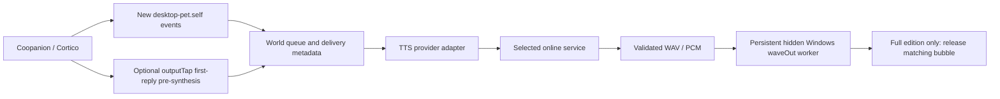

# Architecture

`src/index.js` is the market entry point. `src/world.js` polls the public store cursor and range, excludes history/input/activity, resolves delivery instructions, validates pre-synthesis identity and manages cancellation and ordered playback. Speculation is bounded to one first reply and then the next actual queued phrase.

`src/tts.js` routes credentials and normalized settings to protocol-specific adapters. Transport functions enforce bounded requests/downloads, permitted origins and validated audio. Aliyun WebSocket handshake ownership is independent of model, voice and delivery instructions; a leased socket gets its run-task only after those parameters are known.

Aliyun `onAudioChunk` emits all PCM in approximately 120ms WAV chunks. `src/player-stream.js` sends PCM over JSONL stdin to the hidden Windows PowerShell host compiling `src/native/PcmPlayer.cs`. The worker uses native waveOut buffers, a 300ms initial prebuffer and in-process reset for stop. Other providers currently return whole-response audio through the same player.

Default mood mapping adds no tool or environment prompt. Optional ordinal annotations declare `voice_set_tone({tones:[...]})` and bind by following speech beat order. The model can skip annotations; existing expression metadata and the global instruction are fallbacks.

`full/index.js` adds the immediate store listener and the experimental bubble hook in `full/pet-sync.js`. The hook scopes discovery to loopback pet upgrades, reports connection status and releases bubbles on timeout. The npm file list excludes `full/`. See `upstream-bubble-hook-proposal.md` for the proposed host API.

`web/client.js` is the provider settings/preview panel. `src/credentials.js` uses the host secret store, keeps provider secrets separate, and never returns their values to the panel. Catalog adapters query with the selected provider's credentials and retain labeled presets on failure.
